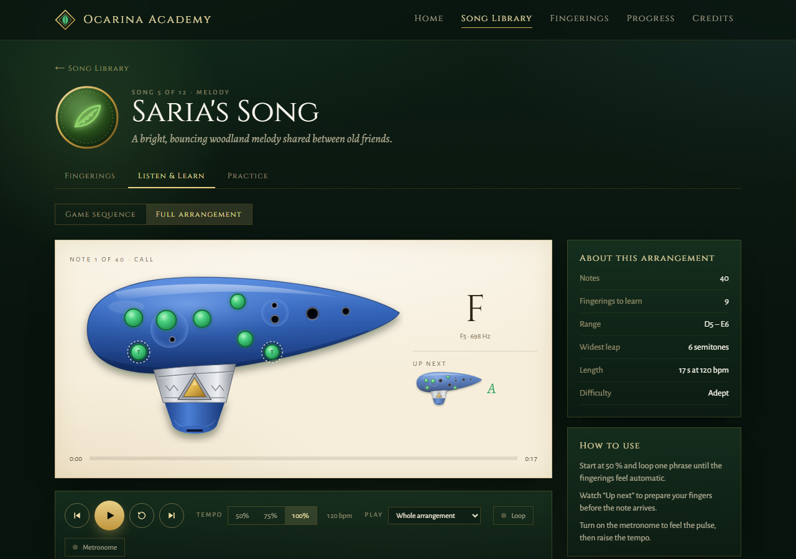
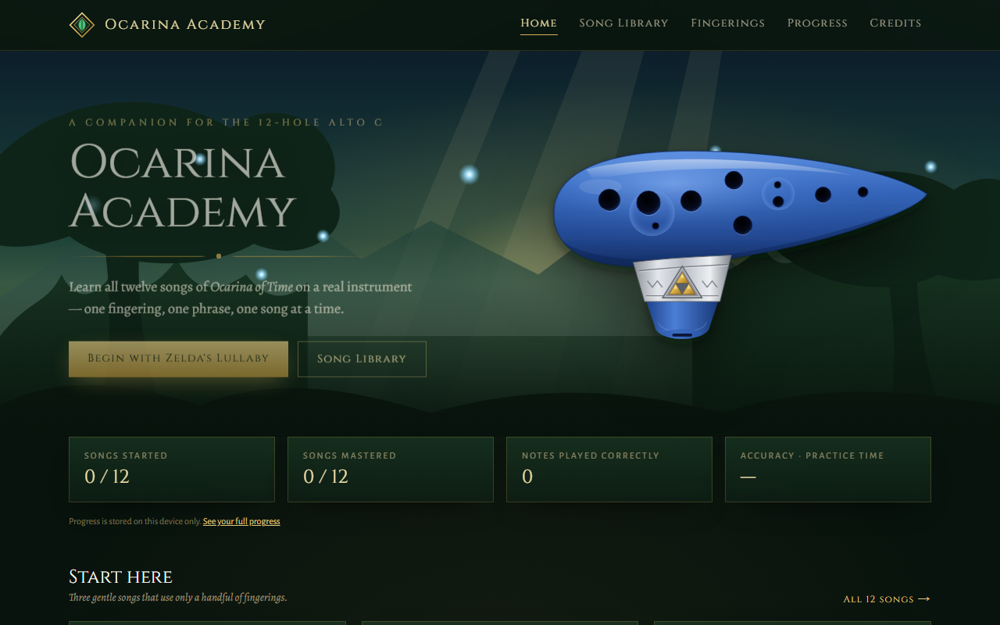
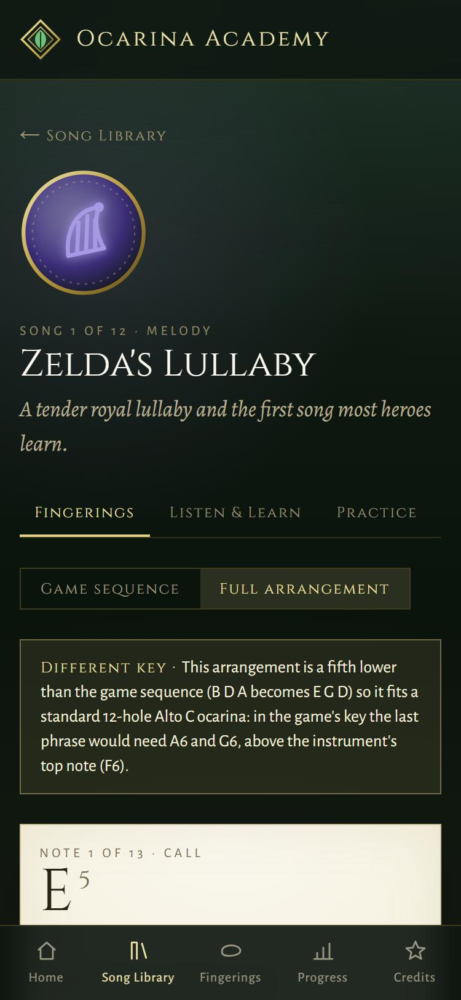

# Ocarina Academy

Learn all twelve songs of *Ocarina of Time* on a real 12-hole Alto C ocarina, one fingering at a time.
Free, no account, works offline.

**▶ Open the app: https://etranqui.github.io/ocarina-academy/**



<p align="center">
  
  &nbsp;
  
</p>

## What you can do

- **See every fingering.** A diagram of the 12-hole ocarina shows which holes to cover, note by note. Step through with the arrow keys or the on-screen buttons.
- **Two versions of every song:** the short sequence you play in the game, and a longer full arrangement of the melody.
- **Listen and play along.** Hear each song at 50 %, 75 % or full speed, loop a phrase, and turn on a metronome. Follow along on the score or the fingering strip.
- **Practice with your microphone.** The app listens as you play and tells you, note by note, whether you hit it, and whether you're sharp or flat.
- **Track your progress:** practice time, a daily streak, accuracy per song and the phrases to work on next.
- **Install it.** Add it to your home screen or desktop and use it offline.

## What you need

- A **12-hole Alto C ocarina**: the classic *Ocarina of Time* replica shape, which plays A4 to F6.
- A recent browser: Chrome, Edge, Safari or Firefox, on a phone, tablet or computer.
- For practice mode, a microphone. Headphones help, so the app hears you rather than its own sound.

## Privacy

Everything runs in your browser. Your progress, calibration and any files you import stay on your
device. There are no accounts, no tracking and no analytics. The microphone is only used while practice
mode is on, and its sound is never recorded or sent anywhere. To move your progress to another
device, use **Progress → Download backup / Restore backup**.

## Credits

The music of *The Legend of Zelda: Ocarina of Time* is by Koji Kondo; the game and its music belong
to Nintendo. The arrangements were put together with help from the ocarina community's tabs. See the
app's [Credits page](https://etranqui.github.io/ocarina-academy/credits/). This is a fan-made learning tool,
not affiliated with or endorsed by Nintendo. All artwork in the app is original.

## License

The code and the original artwork are under the [MIT License](LICENSE). The music is not: the songs
and the game belong to Nintendo.

---

# For developers

See [docs/ARCHITECTURE.md](docs/ARCHITECTURE.md) for architecture, data models, risks and roadmap.

## Run

```bash
npm install
npm run dev        # http://localhost:3000
npm test           # engine unit tests (pitch, fingering, song data validation)
npm run build      # static export to out/ + offline service worker (out/sw.js)
npm run icons      # re-render app icons from scripts/make-icons.mjs
```

## Where things live

| What | File |
|---|---|
| Fingerings + hole geometry | `src/engine/fingering/profiles/oot-replica-alto-c.ts` |
| Ocarina shell artwork | `public/ocarina/replica-shell.svg` |
| Song data (game sequences + chart-based full arrangements) | `src/data/songs.ts` |
| Music schema / timeline (single source of truth) | `src/engine/music/` |
| Progress (LocalStorage) + dashboard | `src/lib/progress.ts`, `src/components/ProgressDashboard.tsx` |
| PWA manifest / service worker | `src/app/manifest.ts`, `scripts/build-sw.mjs` |

## Deploy (no server needed)

`npm run build` writes a fully static site to `out/`. Upload that folder to any static host
(GitHub Pages, Netlify, Cloudflare Pages). Use HTTPS — browsers only allow the microphone
on HTTPS or localhost. To try the built site locally:

```bash
npx serve out
```

**GitHub Pages:** every push to `main` runs `.github/workflows/pages.yml`, which tests, builds with
`BASE_PATH=/ocarina-academy` (Pages serves the site under the repo name) and publishes it to
https://etranqui.github.io/ocarina-academy/. Raw URLs in the code (images, service worker, manifest)
go through `asset()` from `src/lib/basePath.ts`; `next/link` adds the prefix on its own.

## Install & offline

The app is a PWA. On a phone open the HTTPS site and use **Add to Home Screen** (iOS Safari: Share menu;
Android Chrome: Install app). After the first visit every page, song, fingering and the ocarina
voice work offline; progress and imported arrangements stay on the device. Deploying a new build
changes the service worker version, and the app shows *A new version is ready → Reload*. Service
workers only run on HTTPS or localhost, and only in production builds (not `npm run dev`).

Progress lives in this browser only: **Progress → Download backup / Restore backup** moves it
between devices.

## Importing full arrangements

Song page → **Full arrangement** → **Import a full arrangement**. Accepts uncompressed
MusicXML (`.musicxml`/`.xml`) and MIDI (`.mid`). The file is fitted to the Alto C range and
saved in this browser only.

## Rhythm

Every bundled full arrangement has a rhythm and tempo set by ear by the app's author (the tabs and charts give
pitches only). The in-app rhythm editor is switched off; set `RHYTHM_EDITING`
in `src/lib/arrangements.ts` to `true` to bring it back. Imported MusicXML/MIDI files keep their own rhythm.

## Practicing with the microphone

Song page → **Practice**. Turn on the microphone, run **Calibrate** once (stay quiet, then
hold an A), pick Beginner / Intermediate / Advanced and a phrase range. The microphone only
works on HTTPS or localhost. To test on a phone on your Wi-Fi, run the dev server over HTTPS:

```bash
npx next dev --experimental-https -H 0.0.0.0
```
